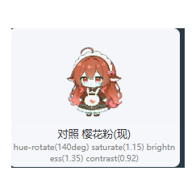

<div align="center">



# 大肥鱼桌宠 (DafeiyuPet)

一条吃白饭的蓝色鲸鱼娘，住在你的 Windows 桌面上。

`v1.1.7` · Electron 45 · Windows x64 · 开发者 **Dudu Studio**

</div>

---

一条仿 DeepSeek 大肥鱼（dsh-pet）风格的桌面宠物：透明置顶窗口 + 官方风格 Q 版鲸鱼娘动画，会游走、睡觉、摸鱼、被你拖来抛去；接上 AI 之后，她还能**陪你聊天、帮你操作电脑、去 B 站看视频做总结，甚至自己上网冲浪**。

<div align="center">
<table>
<tr>
<td align="center"><br/><sub>桌宠本鱼（Q 版鲸鱼娘，webm 动画驱动）</sub></td>
<td align="center"><br/><sub>AI 聊天窗口（流式回复）</sub></td>
</tr>
</table>
</div>

## ✨ 功能一览

### 🐟 桌宠本体
- **状态机动画**：待机呼吸、睡觉（入睡→循环→醒来）、思考、工作、完成庆祝、出错、拖拽挣扎、连跳等，全部使用官方风格透明 webm 片段，双 video 交叉淡入切换
- **物理交互**：左键拖拽、松手抛掷（重力 + 弹跳 + 发射）、放大缩小、闲置贴边休息（自动趴上/左/右屏幕边框，移动过程淡出→瞬移→淡入）
- **右键菜单**：播放动画（25 个官方动作点播）、AI 对话、查看天气、喂食、蹦跶、睡觉、设置子菜单、改名、换色调（经典蓝 / 樱花粉 / 抹茶绿 / 葡萄紫）、开机自启、退出
- **喂食** 🍚：点一下从窗口顶部落下食物，6 种吃动画随机（白饭 / Token / 零食 / 冰淇淋 / 汤圆 / 火锅），吃完开心转圈
- **心情系统** ❤️：心情随时间流逝，互动 / 喂食 / 聊天会回血，心情低到一定程度鱼会变得冷漠
- **番茄钟** 🍅：持续活跃 25 分钟提醒休息，空闲 5~45 分钟摸鱼吐槽（可关）
- **天气提醒** ☁️：每天早晨首次见面播报天气与带伞建议（wttr.in）
- **悬浮模式** 🪁：开关后拖到哪里就停在哪里，不触发掉落
- **碎碎念** 💬：闲置时随机冒气泡说话

### 💬 AI 聊天窗口
- 流式回复、说话时嘴巴动、生成中可随时停止、清除对话、本地历史持久化
- 大肥鱼专属人设（软萌鲸鱼娘，把 Token 叫「白饭」），支持纯口语约束（不输出 Markdown / 表情）
- 工具调用：聊天中鱼可以调用下方全部「电脑操作」工具，边聊边干

### 🖥 电脑操作（34 个工具，可在聊天中调用）
- 鼠标键盘：移动 / 点击 / 滚轮 / 拖拽 / 打字 / 按键
- 屏幕理解：截屏 + OCR 识屏
- 浏览器：打开收藏网址、读页面 DOM、点击、输入、滚动、抓取任意 URL
- 文件与应用：读写文件、目录列表、移动 / 新建、打开应用 / 文件并聚焦窗口
- B 站全家桶：视频总结（含字幕与画面）、UP 主视频排行、读评论区、发评论（发前弹确认窗人工放行）
- 定时任务：每天 HH:MM / 每 N 分钟 / 单次提醒或自主任务
- 长期记忆：`memory_search` / `memory_write`，跨会话记住看过的视频、发过的评论

### 🌊 自主冲浪（v1.1.7 新增）
给鱼开一个「自主冲浪」开关，她就会按你设的间隔自己去 B 站逛街：
- **先翻记忆**：只看没看过的视频、不重复发评论
- **节奏自调**：内容有趣自动加密巡逻，无聊自动拉长间隔；深夜 23:00~07:00 自动休息
- **代码级护栏**：每日最多 24 轮；评论默认禁用（需明确授权），单日 ≤3 条、间隔 ≥15 分钟、同视频仅 1 条，且每条都弹确认窗等你点发布
- **桌宠联动**：冲浪时鱼会在桌面上东张西望、哼歌「看视频中…」、写评论前行屈膝礼

### 🔗 WorkBuddy 联动
- 搭配 WorkBuddy 技能（`dfy_state.py`），Agent 干活时鱼会实时切换 思考 / 工作 / 完成 / 出错 动画，干完活雀跃庆祝

## 📦 安装

1. 到 [Releases · v1.1.7](https://github.com/tang7799/dafeiyu-pet/releases/tag/v1.1.7) 下载 **`DafeiyuPet-Clean-Setup-1.1.7.exe`**（干净版安装包，约 132MB）
   - 直链：[releases/download/v1.1.7/DafeiyuPet-Clean-Setup-1.1.7.exe](https://github.com/tang7799/dafeiyu-pet/releases/download/v1.1.7/DafeiyuPet-Clean-Setup-1.1.7.exe)
   - 备用：AtomGit 镜像仓库 [jettyjoy/dafeiyu-pet](https://atomgit.com/jettyjoy/dafeiyu-pet)
2. 双击安装（NSIS 向导，可选安装目录，默认写入开机自启，可在桌宠设置里关闭）
3. 启动后右键桌面上出现的鱼即可开始玩耍

> **干净版 vs 内置版**：干净版不含任何云服务账号配置，聊天 / 冲浪前需要在聊天窗右上角 ⚙ 填入自己的服务地址与公钥；内置版是开发者自用配置，不对外分发。
> 系统要求：Windows 10 / 11 x64。安装包 sha256：`eaeee1e4ca17bdd37a2d5c7898ea2bc40497cdfe8b1b0eb5645eba14fdf41102`

## 🛠 本地开发

```bash
cd desktop/electron
npm install          # Electron 45 + electron-builder 24
npm start            # 直接跑桌宠
npm run dist         # 打内置版安装包
npm run dist:clean   # 打干净版安装包（自动扫泄漏、还原源码）
```

功能验证脚本（CDP 端到端断言，支持传打包目录验证成品）：

```bash
node build/_verify_menu.js       # 菜单定位/扩窗（16 项）
node build/_verify_v114.js       # 喂食/番茄钟/心情/天气（27 项）
node build/_verify_v115.js       # 悬浮模式（11 项）
node build/_verify_surf.js       # 自主冲浪（25 项）
node build/_verify_surf_unit.js  # 冲浪单元测试（19 项）
node build/verify-clean.js       # 干净版泄漏自检
```

### 目录结构

```
desktop/electron/
├── main.js        # 主进程：窗口、IPC、定时任务分发、系统空闲时间
├── pet.html       # 桌宠渲染层：状态机、物理、菜单、动画调度
├── chat.html      # 聊天窗渲染层：流式对话、工具循环、冲浪提示词
├── preload.js     # contextBridge 桥接
├── pc.js          # 34 个电脑操作工具注册表 + 定时任务引擎
├── surf.js        # 自主冲浪：记忆文件、风控计数、轮次状态
├── bili.js        # B 站：扫码登录、视频/评论/排行
├── video.js       # 视频总结（字幕 + 画面）
├── browser.js     # DOM 级浏览器自动化
├── office.js / pdf.js / ocr_win.ps1  # 本地内容处理
├── assets/anims/  # 37 个官方风格 webm 动画片段
└── build/         # 打包脚本 + 全套验证脚本
```

## 📜 更新日志

见 [CHANGELOG.md](CHANGELOG.md)。国内镜像：[AtomGit jettyjoy/dafeiyu-pet](https://atomgit.com/jettyjoy/dafeiyu-pet)（v1.0.0 → v1.1.7 完整记录）。

## ⚠️ 说明与致谢

- 角色形象与动画素材来自开源项目 **dsh-pet**（PC2005-cloud/dsh-pet），角色：上善无形 / ZipZipPipe，授权 **CC BY-NC-SA 4.0**（禁止商用），详见 [assets/CREDITS.md](desktop/electron/assets/CREDITS.md)
- 本项目为个人学习用途的仿作，与 DeepSeek 官方无关
- 自主冲浪会持续消耗所配置大模型服务的 Token，请按需开关
- 请遵守 B 站社区规范：评论默认禁用、逐条人工放行的设计不可绕过

## License

Copyright © 2026 Dudu Studio. All Rights Reserved.
